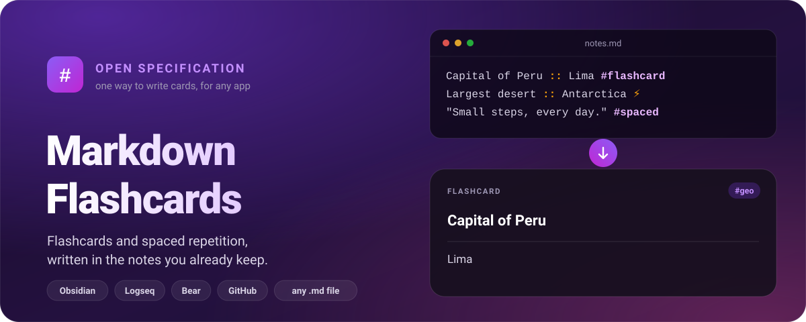
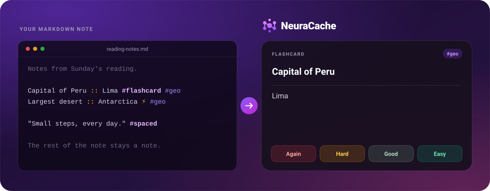
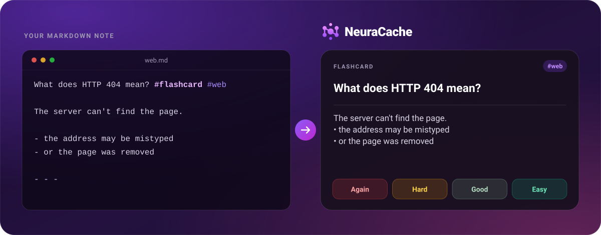
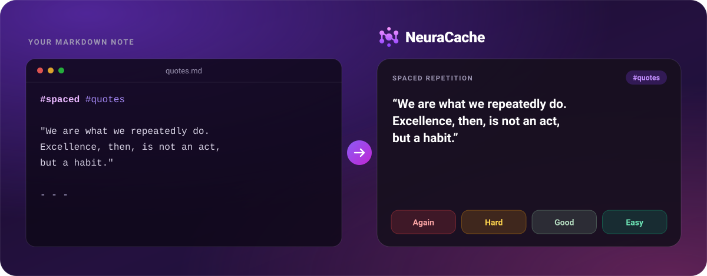
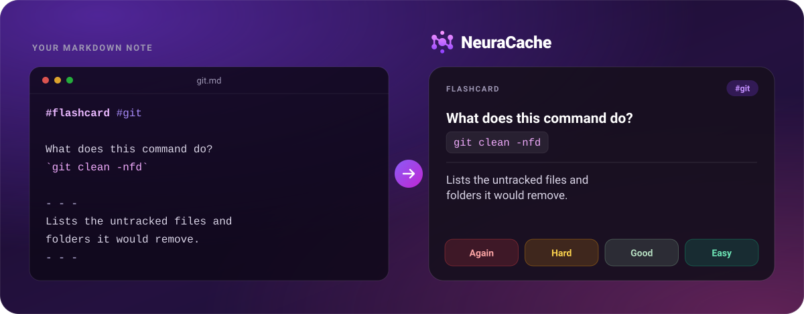
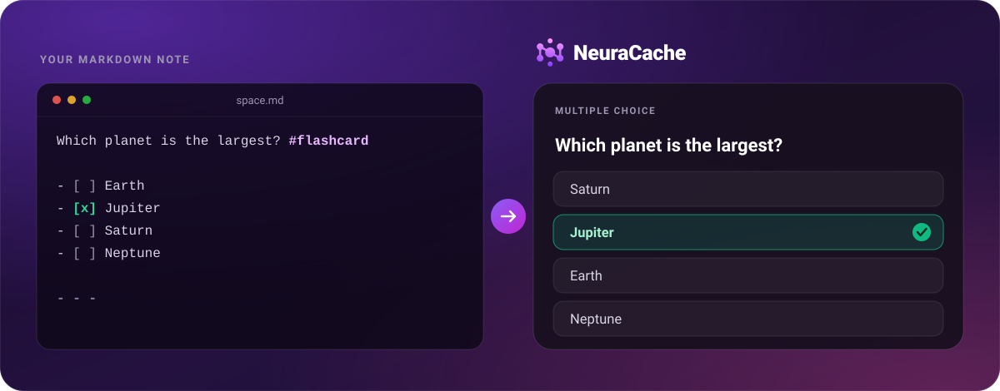
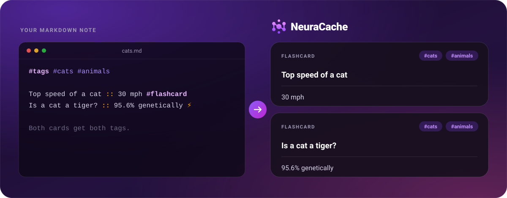
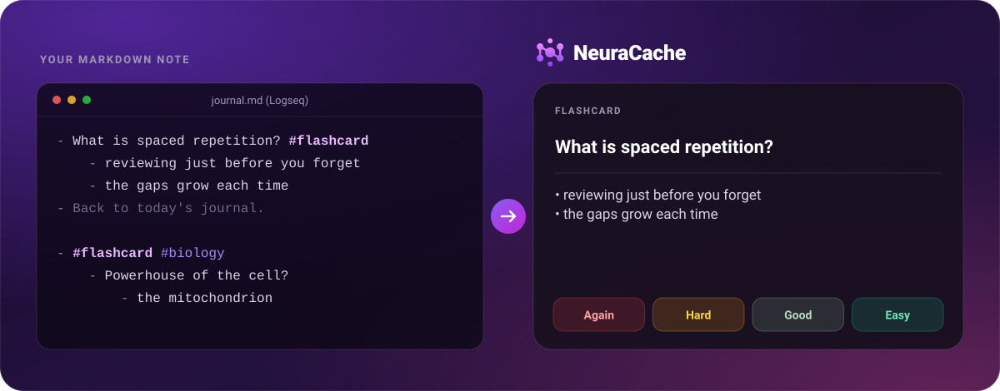
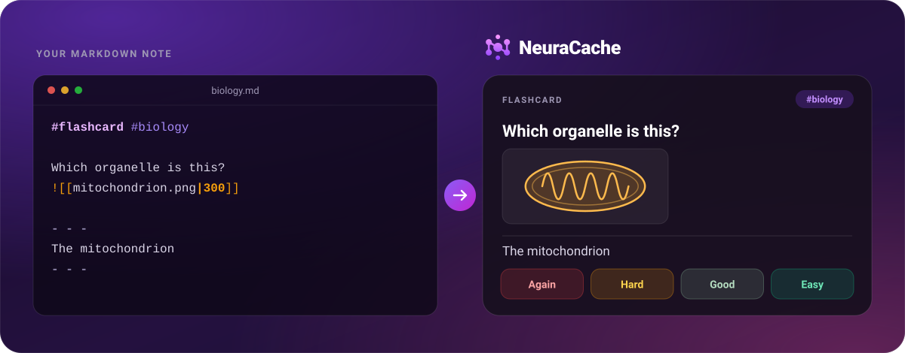

<p align="center">
  
</p>

# Markdown Flashcards & Spaced Repetition

## Goal

This repository aims to standardize the creation of Flashcards and cards for Spaced Repetition in Markdown files.

Add a tag to a line and it becomes a card. Everything around it stays a note. The files stay yours: readable in any editor, easy to version, easy to share, and open to any app that follows the spec.

[NeuraCache](#neuracache) is a compatible, offline-first app that uses this spec.

**[Specification](SPEC.md)** · **[Example note](example_note.md)** · **[Compatible apps](#compatible-apps)**

## Why write cards in Markdown

- **Cards live next to what they come from.** A lecture note, a book highlight, a journal page: the card sits in the same file, in tools like [Obsidian](https://obsidian.md/), [Logseq](https://logseq.com/) and Bear.
- **Decks are portable.** A deck is a text file or a folder. No export step, no lock-in.
- **They don't get in the way.** A card is an ordinary line with a tag, or a small emoji in a GitHub README.

## In 30 seconds

```markdown
Capital of Peru :: Lima #flashcard #geo
Largest desert :: Antarctica ⚡️ #geo

"Small steps, every day." #spaced
```

Three lines, three cards. `::` splits a question from its answer, `#flashcard` (or ⚡️) marks a flashcard, `#spaced` marks a card with one side, and every other tag is a deck.

<p align="center">
  
</p>

This README carries two cards of its own, written the unobtrusive way:

How many people are bitten by snakes each year? :: 5.3M ⚡️

How many people die each year from snake bites? :: ~130k ⚡️

To try the format, import [example_note.md](example_note.md) into a [compatible app](#compatible-apps). It holds one of every card below.

## Card types at a glance

| Card | You write | You get |
| --- | --- | --- |
| [One-line flashcard](#one-line-cards) | `question :: answer #flashcard` | A question and its answer |
| [Micro card](#one-line-cards) | `question :: answer ⚡️` | The same, without a tag in sight |
| [One-line spaced repetition](#one-line-cards) | `a thought worth keeping #spaced` | A card with one side |
| [Regular flashcard](#regular-flashcards) | A question line with `#flashcard`, the answer below, a rule | An answer with lists, images, maths |
| [Spaced repetition block](#spaced-repetition-blocks) | A `#spaced` line, the text below, a rule | A longer card with one side |
| [Two-sided flashcard](#two-sided-flashcards) | A `#flashcard` line, the question, a rule, the answer, a rule | A question that can be as rich as its answer |
| [Multiple choice](#multiple-choice) | A flashcard whose answer is a task list with one item ticked | Pick the right answer |
| [Outline card](#outlines-and-logseq) | A bullet with `#flashcard`, the answer indented under it | Cards from an outliner such as Logseq |

## One-line cards

The quickest cards to write. Each fits on a line.

```markdown
question :: answer #flashcard #optional-tag
question :: answer ⚡️
something to remember #spaced #optional-tag
```

- **Flashcard:** `::` separates the question from the answer.
- **Micro card:** ⚡️ or 🧠 stands in for `#flashcard`. Handy in a README, where a tag would look out of place.
- **Spaced repetition:** no separator. The whole line is the card.

```markdown
⌥⏎ :: follow link #flashcard #intellij #shortcuts
**⌥⏎** :: follow link ⚡️
"We are what we repeatedly do." #spaced #quotes
```

> The first version of this spec used a single colon (`question : answer`). The separator is now `::`, because a single colon turns up in ordinary sentences. An app may still offer the single colon as a setting.

## Regular flashcards

For answers that need room: several lines, a list, an image, a formula.

Put the question and `#flashcard` on one line, write the answer below it, and close the card with a horizontal rule.

```markdown
What does HTTP 404 mean? #flashcard #web

The server can't find the page.

- the address may be mistyped
- or the page was removed

- - -
```

<p align="center">
  
</p>

Any of these rules ends a card: `---`, `- - -`, `***`, `* * *`. The question line can be a heading, so `## What does HTTP 404 mean? #flashcard` works too.

## Spaced repetition blocks

A card with one side: a quote, a principle, a diagram to look at again. The app brings it back at growing intervals.

Start the block with `#spaced` on a line of its own, and close it with a rule.

```markdown
#spaced #quotes

"We are what we repeatedly do. Excellence, then, is not an act, but a habit."

- - -
```

<p align="center">
  
</p>

## Two-sided flashcards

When the question needs more than a line: a picture, a code sample, a paragraph.

Start with `#flashcard` on a line of its own. The question runs to the first rule, the answer to the second.

````markdown
#flashcard #git

What does this command do?

```
git clean -nfd
```

- - -

Lists the untracked files and folders it would remove.

- `n` shows the result first
- `f` files
- `d` directories

- - -
````

<p align="center">
  
</p>

## Multiple choice

A flashcard whose answer is a task list with **exactly one** item ticked becomes a multiple-choice card. The ticked item is the right answer, the others are the wrong ones.

```markdown
Which planet is the largest? #flashcard #space

- [ ] Earth
- [x] Jupiter
- [ ] Saturn
- [ ] Neptune

- - -
```

<p align="center">
  
</p>

- **It is still a plain flashcard on paper.** Editors draw the list as checkboxes, and an app that doesn't support multiple choice shows a flashcard whose answer is the list.
- **Write as many wrong answers as you like.** Each review shows the right one with up to three of the others, in a new order.
- **One tick, at least one unticked.** With no tick, or two, the card stays a regular flashcard, so checklists you already have keep working.
- **Only the list.** Text before or after the list keeps the card a regular flashcard.
- **Change your mind in the file.** Tick a second item, or untick them all, and the card goes back to a regular flashcard at the next sync, with its schedule kept.

The same list works in a two-sided card, under a tag group and in an outline. Multiple choice is new in version 2.0 of the spec. The exact rules are in the [specification](SPEC.md#7-multiple-choice).

## Decks and tags

Every tag on a card's marker line is a deck. A card can sit in several.

```markdown
Capital of Peru :: Lima #flashcard #geography #south-america
```

**Tag groups** save you from repeating yourself. A line that starts with `#tags` gives its tags to every card below it in the file.

```markdown
#tags #cats #animals

Top speed of a cat :: 30 mph #flashcard
Is a cat a tiger? :: 95.6% genetically ⚡️
```

<p align="center">
  
</p>

**Nested tags** such as `#science/physics` put the card in both `#science` and `#physics`.

## Outlines and Logseq

In an outliner, a bullet with `#flashcard` is the question and the bullets indented under it are the answer. The card ends where the outline steps back out.

```markdown
- What is spaced repetition? #flashcard
	- reviewing just before you forget
	- the gaps grow each time
- Back to today's journal.
```

A bullet that holds only the tag turns each of its children into a card:

```markdown
- #flashcard #biology
	- Powerhouse of the cell?
		- the mitochondrion
	- Where is DNA kept?
		- in the nucleus
```

<p align="center">
  
</p>

Indent with tabs, as Logseq does. Logseq's own card properties (`card-last-reviewed::`, `collapsed::` and the like) are left out of the card.

## Images

A picture can sit on either side of a card: in the answer of a regular card, in a spaced repetition block, or in the question of a two-sided card.

```markdown
#flashcard #biology

Which organelle is this?
![[mitochondrion.png|300]]

- - -
The mitochondrion
- - -
```

<p align="center">
  
</p>

| | Write |
| --- | --- |
| **An image on the web** | `` |
| **An image file kept with your notes** | `` or `` |
| **An Obsidian embed** | `![[cell.png]]` |
| **With a width** | `![[cell.png\|300]]` or `` |
| **With a width and a height** | `` |

**Images on the web** need nothing else. The card loads them from their address.

**Image files of your own** have to reach the app together with the note:

- **Sync or import a folder**, and every picture inside it comes along. This is the easy way, and it is how an Obsidian vault or a Logseq graph works.
- **Importing a single file?** Select its pictures in the same step. In NeuraCache on iPhone and iPad, tap and hold the `.md` file, then tap each image ([see it done](https://youtu.be/Q_GD884BpW8?t=219)).

## What a card can hold

Cards are drawn as Markdown, so a card can be more than text.

| | Write |
| --- | --- |
| **Images** | see [Images](#images) above |
| **Maths** | `$E = mc^2$` in a line, `$$ ... $$` on its own |
| **Code** | `` `inline` `` and fenced blocks |
| **Lists and emphasis** | bullets, numbers, `**bold**`, `*italic*` |
| **Highlight and strikethrough** | `==highlight==`, `~~strikethrough~~` |

## Good to know

- **A rule always ends a card.** Any line that contains `---` or `***` closes the card it is in. That includes the divider row of a Markdown table and bold italics written as `***text***`. Keep those out of the middle of a card.
- **Leave a space before the tag.** Write `answer #flashcard`, not `answer#flashcard`.
- **The question is the card.** An app recognises a flashcard by its question and a spaced repetition card by its text. Edit an answer and the card keeps its schedule. Rewrite a question and you have a new card.

## Compatible apps

The format belongs to no single app. Anything that follows the [specification](SPEC.md) can read these notes. Built something that does? Open an issue and it will be listed here.

### NeuraCache


[NeuraCache](https://neuracache.com/) is an offline-first flashcard and spaced repetition app for iPhone, iPad, Mac and Android that uses this spec. No ads, no sign-up, and it works offline.

It imports single files and syncs whole folders, such as an Obsidian vault or a Logseq graph.

Get it on the [App Store](https://apps.apple.com/app/id1450923453) for iPhone and iPad, on [Google Play](https://play.google.com/store/apps/details?id=com.idearoots.neuracache) for Android, or from [neuracache.com](https://neuracache.com/).

| | iPhone, iPad and Mac | Android |
| --- | :---: | :---: |
| One-line, regular, two-sided and spaced repetition cards | ✅ | ✅ |
| Tag groups and nested tags | ✅ | ✅ |
| Outline cards | ✅ | ✅ |
| Images, maths and code in cards | ✅ | ✅ |
| Syncing a folder and importing files | ✅ | ✅ |
| Multiple choice | ✅ | ✅ |

Its settings for Markdown, under **Sources → Markdown**:

- **Rename the tags.** If `#flashcard` or `#spaced` already mean something in your notes, pick other words. Logseq's `#card` works this way.
- **Choose the one-line separator:** `::`, or the older `:`.
- **Turn the emoji markers off.**
- **Let the file lead.** With *Single Source of Truth* on, which is the default, a card you delete from a note in a synced folder leaves the app at the next sync.

Guides on neuracache.com:

| Topic | Guides |
| --- | --- |
| **Start here** | [Markdown flashcards](https://neuracache.com/markdown-flashcards) · [A simple deck](https://neuracache.com/markdown-simple-deck) · [Grouping cards from several files](https://neuracache.com/markdown-grouping-cards) |
| **Your notes app** | [Obsidian](https://neuracache.com/obsidian-flashcards-spaced-repetition) · [Logseq](https://neuracache.com/logseq-flashcards-spaced-repetition) · [Bear](https://neuracache.com/bear-flashcards-spaced-repetition) |
| **One-line cards** | [One-line flashcards](https://neuracache.com/markdown-one-line-flashcards) · [One-line spaced repetition](https://neuracache.com/markdown-one-line-spaced-repetition) · [Micro and two-sided cards](https://neuracache.com/markdown-micro-two-sided-cards) |
| **Regular cards** | [Regular flashcards](https://neuracache.com/markdown-regular-flashcards) · [Regular spaced repetition](https://neuracache.com/markdown-regular-spaced-repetition) · [Spaced repetition cards](https://neuracache.com/markdown-spaced-repetition-cards) |
| **Multiple choice** | [Multiple choice in Markdown](https://neuracache.com/markdown-multiple-choice) |
| **Outlines** | [Indented cards](https://neuracache.com/markdown-indented-cards) |
| **Tags** | [Tags](https://neuracache.com/markdown-tags) · [Tag groups](https://neuracache.com/markdown-tag-groups) |
| **Images** | [Images in cards](https://neuracache.com/markdown-images) |
| **Whole notes** | [Full pages](https://neuracache.com/markdown-full-page) · [YAML headers](https://neuracache.com/markdown-yaml-header) |
| **Syncing** | [Syncing your cards](https://neuracache.com/markdown-syncing-cards) · [Observing a folder](https://neuracache.com/markdown-observe-folder) · [Single source of truth](https://neuracache.com/markdown-single-source-of-truth) |
| **AI assistants** | [Command line tool](https://neuracache.com/command-line-tool) · [Claude](https://neuracache.com/claude-flashcards) · [ChatGPT](https://neuracache.com/chatgpt-flashcards) |

🎥 [One-line and micro cards](https://www.youtube.com/watch?v=6L3Zcm7HqDw) · [Regular cards](https://www.youtube.com/watch?v=RsV3qMUkgoA)

### NeuraCache CLI: Claude Code, Claude and ChatGPT

NeuraCache for Mac 1.6 or later comes with a [command line tool](https://neuracache.com/command-line-tool), `neuracache`. It talks to the app, starting it if it isn't running, and works on your cards. What it adds syncs to your other devices.

| Command | What it does |
| --- | --- |
| `add` | Add cards, multiple-choice ones too |
| `search`, `show` | Find and show any card, whatever its source |
| `edit`, `delete` | Change or remove the cards you made in NeuraCache |
| `decks`, `cards` | List your decks and the cards in them |
| `due`, `stats` | How many cards are due today, and your numbers |
| `focus` | List, create, edit, delete and use your focuses (Pro) |

Add `--json` for scripts and `--help` for the details. **Settings → Command Line** in the Mac app shows how to put `neuracache` on your PATH.

**Connecting an AI assistant.** The same tool is an [MCP](https://modelcontextprotocol.io/) server, so an assistant on your Mac can add cards for you, find and show any card, list your decks and read what's due today. The Mac app has a page for each under **Sources**, with the commands ready to copy.

- **Claude desktop:** Sources → Claude → *Install in Claude*. ([guide](https://neuracache.com/claude-flashcards))
- **Claude Code** ([guide](https://neuracache.com/claude-flashcards)):

  ```sh
  claude mcp add --scope user neuracache -- /Applications/NeuraCache.app/Contents/MacOS/neuracache-cli mcp-server
  ```

- **Codex** ([guide](https://neuracache.com/chatgpt-flashcards)):

  ```sh
  codex mcp add neuracache -- /Applications/NeuraCache.app/Contents/MacOS/neuracache-cli mcp-server
  ```

- **ChatGPT on a Mac:** Settings → MCP servers → Add server, choose STDIO, then enter the tool's path as the command and `mcp-server` as its argument. ([guide](https://neuracache.com/chatgpt-flashcards))

Good to know:

- **Markdown notes stay the source.** A card that came from a note can be found and shown, but it is changed in the note, not through the tool. Cards the tool adds are ordinary NeuraCache cards.
- **It needs the Mac app.** Cards on your iPhone and iPad are reached through iCloud.
- **Your cards' text goes to the assistant.** What the tools return is sent to the assistant you connected and to its model's provider.

## Specification and examples

- **[SPEC.md](SPEC.md)**: every rule, with the edge cases.
- **[example_note.md](example_note.md)**: one of every card, ready to import.
- **[examples/logseq.md](examples/logseq.md)**: the same for an outline.

## Credits

[Marcin Czech](https://x.com/IdeaRoots): regular cards, two-sided cards, tag groups, spaced repetition cards, multiple choice.

[Reto Stamm](https://github.com/retospect): the initial concept of one-line and micro cards.

Questions or ideas? Open an issue, or write to [@IdeaRoots](https://x.com/IdeaRoots) on X.
